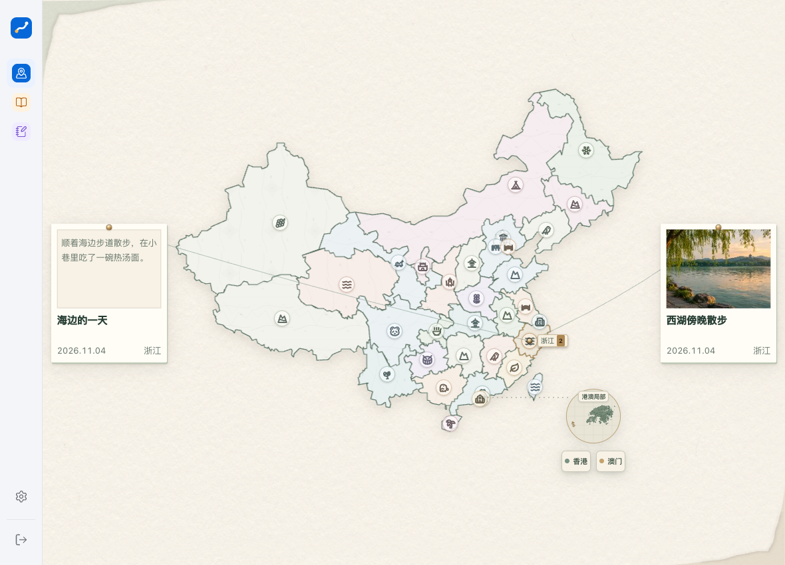
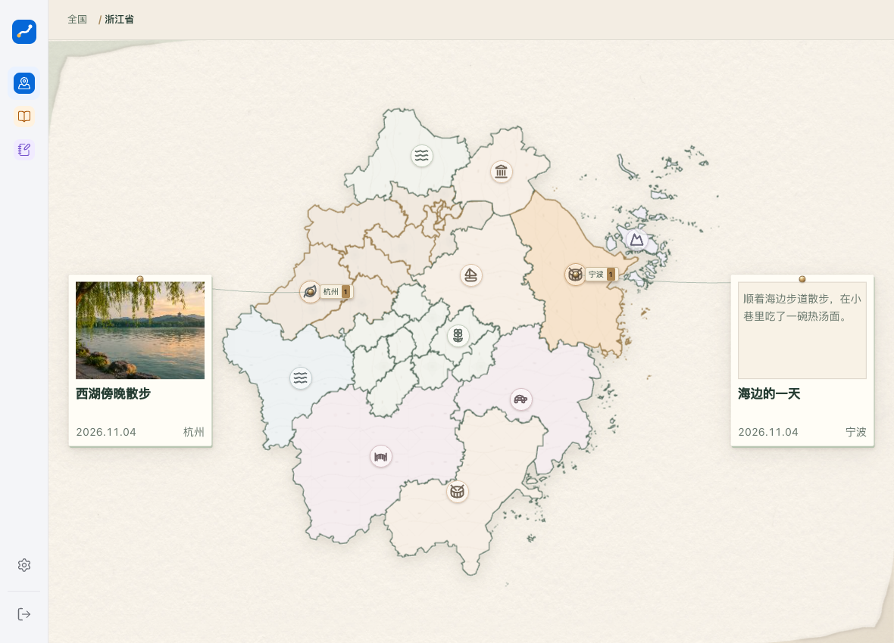
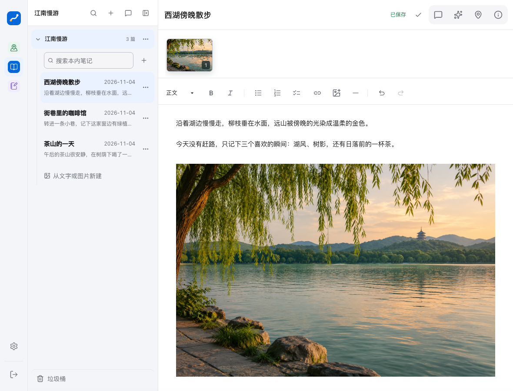
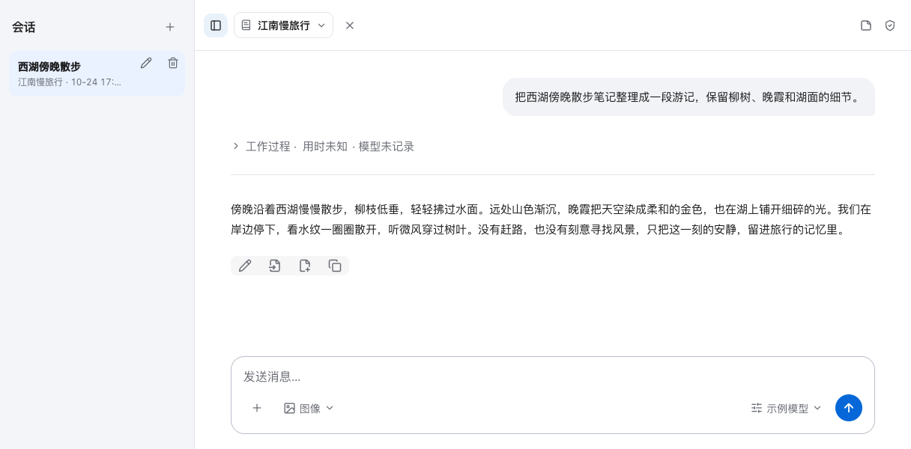
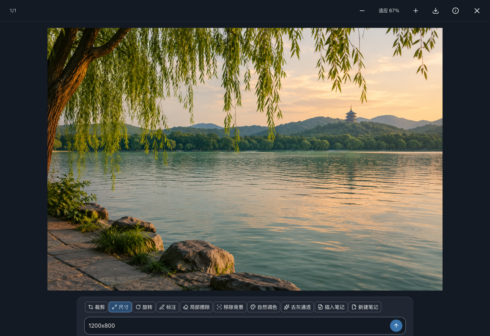

<p align="center"><strong>用地图记录旅途的图文笔记应用</strong></p>
<p align="center">用地图串起旅途，用图文记录见闻，让 AI 帮你整理与创作。</p>
<p align="center">
  <a href="docs/installation.md">安装与配置</a> ·
  <a href="#添加账户">添加账户</a> ·
  <a href="user-guide.md">使用说明</a> ·
  <a href="#功能示例">功能示例</a> ·
  <a href="mobile/README.md">iOS / Android</a> ·
  <a href="#当前版本">版本情况</a>
</p>
<p align="center"><strong>个人学习与交流项目 · 持续更新中</strong> · Web 1.0.0 · App 1.2.0（Build 3）</p>

---

## 从一段旅途，到一页记录

| 功能 | 在行迹里 |
| --- | --- |
| **地图足迹** | 按省、市、县浏览地区，把关联笔记与照片放回地图，查看旅途留下的记录。 |
| **图文笔记** | 用笔记本整理文字与照片，搜索内容、关联地点与日期，自动保存，误删后可从垃圾桶恢复。 |
| **AI 工作台** | 围绕选定笔记对话，引用随记、图片与 Skill；整理文案、生成图片或继续编辑，确认后再写入笔记。 |
| **个性设置** | 日间/夜间主题、自定义指令、模型与记忆管理，让记录和创作顺手衔接。 |

### 图片，也可以继续创作

在查看器里裁剪、调整尺寸、旋转、标注或移除背景；需要进一步创作时，再使用配置好的图片模型。原图保留，编辑结果保存为新版本。

## 功能示例

以下截图展示当前应用界面，使用合成旅记和 [AI 生成的示例照片](public/readme/sample-lake.png)。AI 对话为预编写示例内容。

### 地图，是旅记的入口

把笔记关联到地点，地图就成为旅途的目录。在全国视图看足迹分布，点击照片卡打开原笔记；再进入省、市、县，查看这一带留下的文字与照片。



进入浙江后，杭州与宁波的记录分别回到对应城市；上方路径可以返回全国或上一级地区。



截图用于展示地点浏览与笔记关联功能。完整行政区地图资源包需自行准备，不随源码分发，见[安装说明](docs/installation.md)。

### 把文字与照片写在一起

用笔记本收纳旅行记录，在同一篇正文中添加文字和照片，支持搜索、格式编辑与自动保存。



### 让 AI 帮你整理见闻

选择笔记作为参考，把零散记录整理成游记；结果可以继续修改，确认后再写入笔记。以下对话用于展示界面与用途，使用时需配置自己的模型。



### 继续编辑照片，保留原图

在查看器中裁剪、旋转、改尺寸、标注或移除背景；编辑结果保存为新版本，也可插入已有笔记或新建笔记。



## 当前版本

**持续更新中。** 地图足迹、图文笔记、AI 工作台与图片编辑是当前主要功能，手机体验、兼容性与稳定性会继续完善。

| 部分 | 版本 | 当前情况 |
| --- | --- | --- |
| Web / 服务 | 1.0.0 | 提供源码，按安装说明部署后使用。 |
| iOS App | 1.2.0<br>Build 3 | 已完成模拟器安装与启动；真机安装需要签名。 |
| Android App | 1.2.0<br>Build 3 | 提供原生工程；登录后的工作区加载问题待修复。 |

App 需自行构建和签名，尚未提供正式安装包或应用商店下载。安装方法见 [App 说明](mobile/README.md)。

## 三步开始

1. **连接服务** — 自行部署或接入一个行迹服务，取得账户。初次安装和地图数据准备见[安装与配置](docs/installation.md)。
2. **记下一篇** — 新建笔记本，写文字、添照片，关联地区和旅行日期。无需开启 AI，也可以记录和查看笔记。
3. **按需启用 AI** — 在设置里配置自己的模型服务，并选择相应功能许可。对话、生图与编辑能力、费用取决于所用供应商。

## 添加账户

账户由服务管理员创建，应用内暂不提供自行注册。首次部署时，在项目根目录安装依赖后执行：

```bash
export XINGJI_BETA_ROOT="$PWD/.local/service"
pnpm beta:init
pnpm account account create owner
```

命令会返回用户名和一次性显示的随机初始密码。保存后，用这组信息登录浏览器或 App；`owner` 是示例用户名，可自行替换，用户名支持 3–32 位字母、数字、下划线或短横线。源码没有默认账户、预置密码或模型密钥。

以后添加其他账户，在服务主机上使用**与该服务相同的数据目录**执行，无需重新初始化：

```bash
export XINGJI_BETA_ROOT="$PWD/.local/service"
pnpm account account create traveler
```

如果服务使用其他目录，请将上面的路径替换为实际绝对路径。新账户的随机密码也只显示一次。使用他人部署的服务时，请向该服务管理员申请账户。

登录后，在 **设置 → 模型** 中填写自己的供应商、模型和 API Key，按需同意 AI 与图片功能。完整部署、地图数据与 App 连接方法见[安装与配置](docs/installation.md)。

## Web 与 App

在浏览器中打开行迹服务即可使用。iOS、Android 应用的构建与安装方法见 [App 说明](mobile/README.md)。

笔记整理、图片编辑、模型配置与资料备份，见[使用说明](user-guide.md)。

## 学习与使用说明

行迹用于个人学习、技术实践与交流，建议在个人学习环境中体验，不构成商业服务承诺或专业建议。

- **源码权利**：自有源码尚未采用开源许可证。GitHub 上的公开浏览与站内 Fork 按平台条款进行；公开可见不等于授予任意使用、修改、再分发或商业使用的许可。其他用途请先确认授权，参见 [GitHub 的许可证说明](https://docs.github.com/en/repositories/managing-your-repositorys-settings-and-features/customizing-your-repository/licensing-a-repository)。
- **第三方资源**：代码依赖、模型、Skill、地图、照片与纹理分别遵守适用的许可及权利要求；请保留要求的版权、来源与许可声明。“学习用途”不会替代授权，也不会改变第三方许可证已授予的权利。完整行政区地图包需自行取得合法授权。
- **模型与内容**：使用自己的供应商账户，遵守服务条款并承担相应费用。AI 输出可能有误，发布或使用前应核实内容及相关权利，不得用于侵权或违法活动。
- **数据与部署**：仅处理有权使用的数据，保护个人信息、位置和照片隐私，妥善保管密钥并备份资料。部署、对外服务或二次分发前，应评估安全、合规与资源授权要求。

项目不保证满足特定用途、持续可用或特定合规要求。以上说明不替代适用法律、第三方许可或专业意见，也不构成免责保证。

---

**资源与许可** · 随附模型权重、底图、纹理和 Skill 的来源与许可，见[第三方资源说明](docs/third-party.md)。
